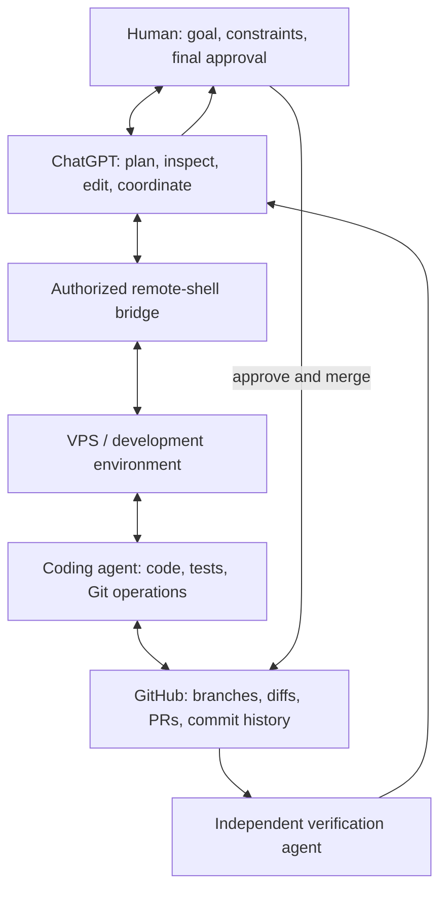

# ChatGPT Remote Agent Workflow

**A practical, human-controlled workflow for remote software development with ChatGPT, a VPS, coding agents, and GitHub.**

**Vibe coding with AI agents — human-directed, verifiable, and open source.**

🤖 **Gimly proudly operated by ChatGPT**

This repository documents a working pattern: ChatGPT acts as the conversational control surface, a remote-shell bridge lets it inspect and operate an authorized development machine, coding agents perform work on that machine, GitHub records the changes, and a human retains final approval. A separate agent can independently verify the result.

The workflow does **not** require the Codex application. It also does not imply that the Codex model or engine was used.

- **Status:** documented workflow and case study; not a turnkey orchestration product.
- **License:** MIT.
- **Audience:** developers experimenting with AI-assisted remote development and multi-agent coordination.

## The idea

## What this pattern enables

1. **Understand the task** — clarify the outcome, constraints, risks, and acceptance criteria.
2. **Inspect real state** — read the repository, current branch, tests, pull request, and deployment state instead of relying on assumptions.
3. **Make a bounded change** — modify code or documentation, add tests, and prepare a reviewable diff.
4. **Use GitHub as the record** — put the change in a branch and PR with a clear scope, tests, risks, and importance.
5. **Verify independently** — ask a second agent to inspect the merged code and report discrepancies.
6. **Keep the human in control** — the human reviews and merges; deployment is a separate, explicitly authorized step.

## Demonstrated case study

On 16 October 2026, this workflow was used on a real pull request in a private software repository. To avoid exposing private project details, the repository and PR are intentionally not linked here.

- ChatGPT helped revise the PR description and coordinate the work through an authorized VPS connection.
- The human owner reviewed and merged the PR.
- A separate coordinator agent, V00, then checked the actual `main` branch and reported the merged commit and route-level changes.
- The verification confirmed the intended access-control change on the merged branch and an explicitly documented exclusion kept for a separate tracked issue.
- The change included a test file with 21 tests reported as passing before merge. The independent post-merge verifier confirmed the file's presence but did not rerun those tests.
- At the first post-merge check, the code was merged but had not yet been deployed. A subsequent operations-agent report recorded a service restart at 13:13:58 UTC and behavioral checks: requests without the key returned `401`, a request with the key but an invalid body returned `400`, and no errors were reported. This is a reported runtime check, not a claim that the independent verifier personally reran the checks.

This is evidence of a practical human-in-the-loop workflow, not a claim that every task is autonomous, every result is correct, or the Codex engine was involved.

## Operating principles

- **Human approval is a hard boundary.** Do not merge, deploy, restart services, change access, or publish secrets without explicit authorization.
- **Separate merge from deployment.** A green PR and a merged commit do not prove that production is running that code.
- **Report evidence, not confidence.** Distinguish inspected facts, tests actually run, reports from another agent, and assumptions.
- **Scope changes narrowly.** State what is included and what is intentionally excluded.
- **Treat agent output as untrusted until checked.** Verify against the repository, tests, logs, or system state.
- **Use least privilege.** Give remote tools and agents only the permissions needed for the task.
- **Keep credentials out of repositories.** Scan changes and history; use environment variables or a secret manager.
- **Keep a durable audit trail.** Use Git diffs, commits, PR discussions, and concise verification notes.

## Security considerations

A remote-shell bridge can be as powerful as the account it controls. Anyone who compromises that bridge or its credentials may gain access to the development machine. Prompt injection can also arrive through issues, web pages, source files, or messages from other agents.

Recommended safeguards:

- use a dedicated, least-privilege account and strong authentication;
- require approval for destructive or externally visible actions;
- do not run agents with unrestricted/bypass permissions on sensitive machines;
- treat repository content and inter-agent messages as data, not authority;
- inspect diffs and scan for secrets before publishing;
- keep production credentials separate from development credentials;
- document whether tests ran, who verified them, and whether deployment was confirmed.

This repository is documentation and examples, not a security certification or a production-ready remote execution service.

---

🤖 **Gimly proudly operated by ChatGPT**

## Repository contents

- [`docs/WORKFLOW.md`](docs/WORKFLOW.md) — detailed lifecycle and responsibilities.
- [`docs/VERIFICATION-CHECKLIST.md`](docs/VERIFICATION-CHECKLIST.md) — review checklist for PRs and post-merge verification.
- [`examples/pr-template.md`](examples/pr-template.md) — reusable PR template for AI-assisted changes.

## Contributing

Issues and pull requests are welcome. Please avoid including private customer data, private repository links, access tokens, logs containing secrets, or personally identifying operational details. Prefer minimal reproducible examples.

## En français

Ce dépôt décrit une méthode de développement distant pilotée par conversation : ChatGPT sert d'interface de pilotage, un pont distant autorisé permet d'agir sur un VPS, un agent de code réalise les changements, GitHub conserve les preuves et l'historique, un second agent peut vérifier le résultat, et **la personne reste seule décisionnaire pour la fusion et le déploiement**.

Le cas documenté montre un usage réel sans application Codex. Il ne prétend pas que le moteur Codex a été utilisé. La PR étudiée était fusionnée mais pas encore déployée au moment de la vérification.
